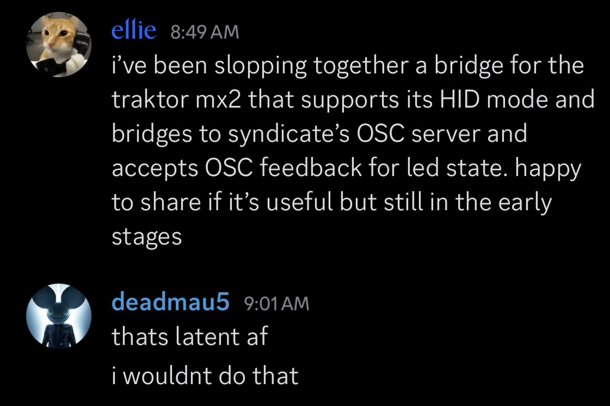

# Indirect Input

A little protocol DI box: **Traktor MX2 in, clean OSC out.**

Indirect Input is a small macOS app that lets you play Syndicate
from a Native Instruments Traktor MX2. It reads the controller directly over USB, turns
buttons, knobs and platters into Syndicate's OSC messages, and lights the MX2's RGB
pads, buttons and meters from what Syndicate reports back.

There is no MIDI mapping to set up, no virtual MIDI device, and no third-party code.

## What you need

- A Mac running macOS 13 or later
- A Traktor MX2, connected over USB
- Syndicate, with OSC (see [chapter 14 of its user guide](https://untitledaudiosyndicate.com/docs?c=c14-2))
- Xcode or the Swift 6 toolchain, to build the app

## Install

There is no prebuilt download yet, so build it once from a checkout of this repo:

```sh
./scripts/build-app.sh --install
open "$HOME/Applications/Indirect Input.app"
```

This puts **Indirect Input.app** in `~/Applications`. Leave off `--install` to build
`dist/Indirect Input.app` without installing it.

## First-time setup

You do this once. After that, open both apps and play.

1. **Plug in the MX2 and open Indirect Input.** The MX2 must be in native mode, not MIDI
   mode. The *HID connection* light turns green.
2. **Turn on OSC input in Syndicate.** In Syndicate's settings, enable **OSC INPUT** on
   port **9090**.
3. **Turn on OSC feedback in Syndicate.** This step is easy to miss, and without it
   nothing on the controller lights up.
   - Go to **Settings → OSC FEEDBACK**.
   - Set the destination to `127.0.0.1:9096`.
   - Tick the subscriptions. Start with **Playing, PlayPending, Item Info, Cues, Loop,
     Meter, PlayerType and Progress**. Item Info tells the deck a track is loaded, and
     Progress lets the platter seek from where the track is playing. Add the sampler
     values if you use the sampler.
4. **Load a track and click Resend feedback** in Indirect Input (or **RESEND STATE** in
   Syndicate). The *OSC feedback* light turns green and the deck lights up.

An empty deck has almost nothing to show, so load a track before you judge the lights.

### Choosing decks and pad modes

- **Deck pair** picks whether the MX2 controls Syndicate decks **1 + 2** or **3 + 4**.
- **Set both pad banks** switches both sides at once. The bank buttons on the controller
  still switch each side on its own.

## What the controls do

| Works | Not mapped, on purpose |
| --- | --- |
| Play, cue, sync, keylock, reverse, flux | Crossfader |
| Browser: scroll, load to deck, view mode | Preview |
| Hotcues (with colours from Syndicate) | Microphone |
| Slip loops, loop in/out/size/move | Centre filter button |
| Sampler: choose and mute lanes | Stem pads |
| Gain, EQ, filter, volume, FX macro knobs | Global quick-effect buttons |
| Master volume, cue mix, cue volume, tempo | |
| Platter: bend, seek when touched, zoom with SHIFT | |
| RGB pads, buttons, deck glow and level meters | |

The unmapped controls have no matching route in Syndicate's OSC API, so they stay
dark instead of guessing. The sampler pads choose and mute lanes; they do not trigger
samples.

The [control inventory](docs/mx2-control-coverage.md) lists the exact OSC message for
every control, plus what has not been checked on hardware yet.

## Troubleshooting

**Nothing lights up.** Feedback is almost always the cause. Check that the *OSC
feedback* light says *Received*. If it says *Listening*, Syndicate is not sending:
check the destination (`127.0.0.1:9096`) and the subscriptions, then click
**Resend feedback**.

**The feedback light says Error.** Something else is already using port 9096, most
often a second copy of Indirect Input. Quit it and reopen the app.

**The controller does nothing.** Check that the *HID connection* light is green. If
Traktor is running, quit it, since it may claim the controller first. Also check the
MX2 is in native mode, not MIDI mode.

**RGB says Accepted, but the LEDs are dark.** *Accepted* means macOS took the frame,
not that the LEDs lit. Check the feedback steps above.

**Syndicate is on another Mac.** Click **Edit address…** next to *OSC destination*
and enter that Mac's address. Feedback still has to come back to this Mac on port
9096.

**Syndicate settings… does nothing.** It types Command-comma into Syndicate for you,
which needs Accessibility access. Allow Indirect Input under **System Settings →
Privacy & Security → Accessibility**.

**Something else.** **Reveal diagnostic log** (in the window or the app menu) opens
`~/.local/state/indirect-input/native-events.log`, which records every input, every
outgoing OSC message and every status change. It rolls over to `native-events.1.log`
at 8 MiB, so it never grows past about 16 MiB.

## Development

```sh
swift test                          # all test suites
swift test -c release --filter MX2LatencyBenchmarkTests   # latency benchmark
```

- `Sources/MX2Native`: reads the MX2 over HID and maps controls to OSC.
- `Sources/MX2Feedback`: receives Syndicate's feedback and renders the LED frame.
- `Sources/IndirectInputApp`: the SwiftUI app that connects the two.
- [docs/mx2-native-protocol.md](docs/mx2-native-protocol.md): how the MX2's reports
  were worked out.
- [docs/latency.md](docs/latency.md): how fast the input path is, and how it was measured.
- `scripts/fetch-syndicate-osc-docs.sh`: prints Syndicate's OSC chapter as text. Diff it
  against an older copy after a Syndicate update to see which routes changed.

The app is ad-hoc signed, not notarized. The patch-cable icon lives in
`Resources/AppIcon.svg`; `bash Resources/build-icon.sh` rebuilds the PNG, iconset and
ICNS from it (needs librsvg or Nix, plus `sips` and `iconutil`).

## Architecture review



he’s probably right. i already had the deck.

[Latency measurements](docs/latency.md), for anyone else who already has the deck.
